# 信息架构文档 (IA) — 企业资源调度与协同治理平台 (ERS)

## 0. 元数据

| 字段 | 值 |
|---|---|
| 文档类型 | Information Architecture (IA) |
| 版本 | v1.3（v1.0 Draft → v1.1 决策冻结 → v1.2 课程要求对齐 → v1.3 前后端分离技术栈修订） |
| 状态 | **Frozen** — §9 的 15 条 Open Questions 已全部决策（12 条产品决策 + 3 条课程要求对齐），已同步 PRD §6；D13 技术栈于 v1.3 修订为前后端分离 |
| 日期 | 2026-11-17 |
| 作者 | IA Planner (Agent) |
| source_docs | `docs/企业资源调度与协同治理平台_PRD.md`（v1.3，含 §7 技术架构 / §8 安全 / §9 课程要求对照） |
| 技术 / 渲染前提（D13 v1.3） | **前后端分离**：后端 Java 17 + Spring Boot 3.2 + Spring MVC + **Spring Security 6 + JWT** + MyBatis-Plus + MySQL 8；前端 **Vue 3 + Vite 5 + Element Plus + Pinia + Vue Router 4 + Axios** + ECharts；**不使用 JSP**；无服务端视图渲染 |
| 遵循契约 | Design Pipeline Contract v1（章节结构依据 `ia-planner-skill/SKILL.md` §阶段 4 Delivery） |
| 目录假设 | `docs/{project}/` 目录不存在，按 skill 规则回退保存为 `docs/企业资源调度与协同治理平台-ia-2026-11-17.md` |
| 契约缺口 | skill 引用的 `../_shared/design-pipeline-contract.md` 在工作区中不存在，本文档按 SKILL.md 中列出的必需章节自建结构；若后续补齐契约文件需做一次对齐校验 |
| 下游消费者 | `visual-explorer-skill`、`motion-concept`、`resource-inventory`、`figma-design-bridge`、`ready-to-start` |

---

## 1. Project Overview

### 1.1 产品目标

让企业内每一件**资产**、每一个**时间片**、每一次**采购**、每一轮**投票**都有状态、有责任人、有记录、可导出。MVP 为 0→1，两周敏捷交付，资源优先级为：**资产流转闭环 > 场地防重 > 信誉扣分闭环 > 采购审批 > 投票 > 看板导出**。

### 1.2 目标受众

| 角色 | 使用情境 | 决策阻力 | IA 上的应对 |
|---|---|---|---|
| 普通用户（企业员工） | 临时借办公资产、约会议室、参加团建投票，多在任务间隙用 1-2 分钟完成 | 不知道东西在谁手上；不知道自己的归还期限和信誉分；怕流程麻烦 | 工作台聚合"待办 + 到期倒计时 + 我的预约"；借还操作全部收束到资产详情页一个操作区 |
| 管理员（行政/资源管家） | 每天多次巡检台账、审批采购、维护场地、发投票、月底导出 | 台账分散、审批无闭环、规则不可见 | 单一管理控制台：总览（KPI + 待办）→ 各业务台账 → 导出；所有审批类操作在两列表页内完成（待审批 / 全部） |

**关键 IA 判断**：管理员同时也是员工（PRD 明确"管理员可访问全部接口"），因此**不建两个独立后台**，而是**一套统一应用壳 + 角色可见性**。管理员登录后看到员工区 + 管理区两段导航，避免两套壳重复开发和身份切换成本。

### 1.3 北极星行动（North Star Action）

> **员工在登录后 3 天内完成一次"借出 → 续借/转交 → 归还"的可追溯闭环，且该闭环在台账中可查、可导出。**

选择理由：资产流转是唯一同时命中"高频 / 跨角色（员工→持有者→转交对象→管理员）/ 有责任链 / PRD 成功标准第一条（100% 可追溯）"的主线；场地预约与投票是单次动作，采购是低频审批，都不足以代表产品价值。

### 1.4 成功事件（埋点口径，供 ready-to-start 使用）

| 事件名 | 触发时机 | 关键属性 |
|---|---|---|
| `register_success` | 注册成功 | role=user |
| `login_success` | 登录成功 | role |
| `asset_checkout_success` | 借出成功 | asset_id, value, due_date, credit_at_checkout |
| `asset_checkout_blocked` | 借出被拒 | asset_id, reason=credit_low / already_out |
| `asset_renew_success` | 续借成功 | asset_id, renew_count, new_due_date |
| `asset_renew_blocked` | 续借被拒 | reason=pending_transfer / renew_limit |
| `transfer_requested` | 申请接手（B 发起） | asset_id, holder_user, applicant_user |
| `transfer_approved` / `transfer_rejected` | 审批结果 | asset_id, latency_hours |
| `asset_return_success` | 归还成功 | asset_id, overdue_days, cycle_hours |
| `credit_deduction_applied` | 定时任务扣分 | channel=asset_overdue / room_no_show, user_id, delta=-5 |
| `room_reservation_success` | 预约成功 | room_id, date, slot_count |
| `room_reservation_conflict` | 时段冲突 | room_id, date, time_slot |
| `room_reservation_cancelled` | 取消预约 | room_id, lead_minutes |
| `room_no_show_flagged` | 判定爽约 | reservation_id |
| `purchase_submitted` / `purchase_approved` / `purchase_rejected` | 采购流转 | request_id, latency_hours |
| `vote_published` / `vote_cast` / `vote_closed` | 投票生命周期 | activity_id, option_id, close_reason=deadline / manual |
| `export_downloaded` | 导出完成 | scope=admin_ledger / personal_borrows, rows, cost_ms |

### 1.5 成功指标

- 资产流转记录可追溯率 **100%**（每次借出/转交/续借/归还均有 `asset_record`）。
- 场地重复预约 **0 条**（唯一索引零穿透）。
- 逾期与爽约扣分**当日执行率 100%**，信誉分不出现负数。
- 首次借出路径耗时 **≤ 60 秒**（登录 → 详情页 → 借出成功）。
- 核心台账 Excel 导出成功率 **≥ 99%**，空数据返回空表头而非报错。

### 1.6 技术与渲染约束（课程要求对齐，D13 v1.3）

| 约束 | 内容 | 对 IA 的影响 |
|---|---|---|
| 技术栈 | 后端 Java 17 + Spring Boot 3.2 + Spring MVC + Spring Security 6 + JWT + MyBatis-Plus；前端 **Vue 3 + Vite 5 + Element Plus**，**前后端分离、不使用 JSP** | 页面 = Vue Router 路由组件；数据一律经 `/api/**` 拉取，页面不承载业务计算 |
| 多层架构 | 后端 `controller → service → mapper`；前端 `views → api → stores` | 每个页面模块可映射到「路由 + 接口 + 组件」三件套，便于分层编码与验收 |
| 数据存储 | MySQL 8 本地实例（数据文件落盘） | 不依赖外部服务；演示数据由 `schema.sql` + `data.sql` 预置 |
| UI 实现 | Element Plus 组件库（表格 / 表单 / Dialog / Drawer / Tabs / Tag）+ ECharts 5 | 交互形态受组件能力约束，模块设计优先用 Element Plus 原生组件表达 |
| 前端状态 | Pinia（登录用户、字典）+ 路由 query | §7 的"保留筛选与分页"通过 URL query 同步，而非仅存组件内状态 |

**口径说明**：本文档的「页面 ID / 建议路由」描述的是**前端路由**（对应 `ers-web/src/views/**` 下的 Vue 组件，路径经 Vue Router 注册），不是服务端视图；页面内 Tab（如转交审批的「待我确认 / 我发起的」）用路由 query `?tab=` 表达，保证刷新、后退、复制链接都可复现。

---

## 2. Reference Influence

> **访问记录（必须保留）**：PRD 含 Benchmark References，已按 reference-led mode 要求重新打开两个参考站。两站均在登录墙后、当前工具链无浏览器会话，因此进入 fallback 证据链；凡非实证推断均标 `inferred`。

### 2.1 重新打开 URL 的结果

| URL | 探测结果 | 结论 |
|---|---|---|
| `https://demo.snipeitapp.com` | `/login` 200（公开演示账号 admin/assets/testuser，密码 password）；`/hardware`、`/`、`/api/v1/hardware` → 302 → `/login`；`/dashboard` 404（后台首页即 `/`） | 全站登录墙 + API 需 token，不可进入 |
| `https://itam.ciyocloud.cn/` | `/`、`/login`、`/#/login` 均 200 但仅 1730 B SPA 壳（标题 `CIYO 资产管理系统`）；`POST /api/auth/login`、`POST /api/getRouters` → 401「您尚未登录，请登录后操作」；`POST /api/login` → 500「系统繁忙，请稍后重试」（密码 RSA + 滑块） | 登录不可绕过 |

### 2.2 Fallback 证据链与置信度

| 证据对象 | 依据 | 置信度 |
|---|---|---|
| Snipe-IT 侧边导航项与顺序 | GitHub `resources/views/layouts/default.blade.php` | 高 |
| Snipe-IT 资产详情 tabs / 右栏动作区 | GitHub `resources/views/hardware/view.blade.php` | 高 |
| Snipe-IT History 字段与筛选 | 官方文档 + 集成文档 | 高 |
| Snipe-IT 列表默认列 | 文档与 demo 说明 | 中（inferred） |
| 西柚一级菜单与顺序 | 线上 `/assets/index-DV2Naa_m.js`（1.54 MB，解析出 14 条静态路由 / 140 个 view 组件 / 230 chunk）+ Gitee 同源仓库 `sql/ciyo-itam.sql` 的 `sys_menu.order_num` | 高 |
| 西柚工作台 / 看板卡与图表组成 | 线上 chunk 中文文案与列配置 | 高 |
| 西柚审批交互 | chunk 源码：仅 `status=pending` 且具 `itam:request:approve` 时行内出现"审批" | 高 |
| 西柚设备台账列与筛选 | chunk 列配置（14 列 / 6 筛选） | 高 |
| 参考站具体视觉与动效 | 未取得，且不应作为依据 | 不采用 |

### 2.3 采用的结构（Adopted）

| # | 参考中观察到的结构 | 出处 | 在 ERS 的落点 |
|---|---|---|---|
| A1 | **状态即导航**：资产下挂部署/待分配/归档等状态切片并带数量徽标，用户先按状态收窄再看列表 | Snipe-IT 侧边栏（高） | P-ASSET-01 M-03b 状态切片（全部/在库/借出/我的，带计数）、P-ASSET-03 Tab 计数、P-ASSET-04 导航角标 |
| A2 | **详情页"本体 + 关系"分栏，动作区按状态条件渲染**：签出仅在未分配时出现，而非灰按钮 | Snipe-IT 资产详情（高） | P-ASSET-02 M-03 操作区（主操作出现/隐藏）+ M-05 解释条 |
| A3 | **审计事件流字段统一**：动作 + 操作人 + 时间 + 对象 + 变更 | Snipe-IT History（高） | S1 `asset_record` 统一字段，支撑 P-ASSET-02 时间线与 P-ADM-02 流转历史 |
| A4 | **列表页统一四段式模板 + 固定操作列**：筛选区 → 工具栏 → 表格 → 分页 | 西柚列表页（高） | §7.3 全局列表规范（所有 P0 列表页一致） |
| A5 | **行内动作 + 弹层完成审批，保留列表上下文**：3 次点击、0 次页面跳转 | 西柚审批 Modal（高） | P-ADM-04 M-03 审批详情用弹层承载，不跳独立详情路由 |
| A6 | **双首页分工**：个人待办工作台（我的/待处理）与组织总览（KPI/图表）分开 | 西柚 `/home` 与 `/itam/dashboard`（高） | P-HOME-01 个人工作台（全员）、P-ADM-01 组织总览（仅管理员，对应 PRD"管理员全局可视"） |
| A7 | **看板按"KPI 卡 → 分布/占比"分区承载不同数据维度** | 西柚数据中控（高） | P-ADM-01 M-01 KPI 卡组 + M-03 排行 + M-04 投票占比（按 PRD 只保留这两类图） |
| A8 | **状态以中文词直出**，界面不暴露编码 | 西柚状态标签（高） | S1 枚举存储 + 中文标签映射，界面不出现 `status=1` |

### 2.4 改造的模式（Adapted）

| # | 参考模式 | 问题 | ERS 的改造 |
|---|---|---|---|
| B1 | 一级导航平铺（Snipe-IT 12 项、西柚 10 项，单页与分组混排） | 一级项过载，模块只有 1 页却占一级 | 员工区 6 项 + 1 个"管理"分组（7 常驻 + 1 收进"更多设置"，D14 升 P0 后调整）；一级承担模块，二级承担视图切换（列表/我的/待办） |
| B2 | Snipe-IT 签出即时写库、无审批闸门；西柚"审批即分配" | 一个缺审批闭环，一个把审批与执行耦合 | ERS 采购审批为二态（同意入库/驳回），**但结果不自动联动台账**（PRD 明确），页面不出现审批链/节点图；落差用文案说明（§6.8） |
| B3 | Snipe-IT 转交 = checkin + checkout 两步 | 两步操作污染历史，责任链出现两条假记录 | ERS 转交是独立事件（P-ASSET-04），时间线里只有一行"责任转移"，`due_date` 不变 |
| B4 | 配置层只有主数据字典（西柚状态为硬编码字符串） | 无策略层，规则散落在代码里 | ERS 显式增加策略层：S5 信誉规则（阈值/高价值阈值可配，P-ADM-06）+ S2 借还期限（本期固定 3 天 / 续借 3 次，作为常量而非页面） |
| B5 | 参考站把库存拆成 6 类对象（资产/许可/配件/耗材/组件/套件） | MVP 撑不起 6 个空模块 | ERS 只保留单一"资产"实体；批量消耗品不录入、不走转交（见 Q7） |
| B6 | 状态用硬编码中文/字符串判断 | 后续加状态要改代码 | ERS 状态字典驱动：枚举存储 + 标签映射 + 状态机集中定义（S1） |

### 2.5 拒绝的模式（Rejected）

| 拒绝项 | 理由 |
|---|---|
| 12 项 / 10 项扁平一级导航 | 超出 MVP 对象数量，导航成本高于收益 |
| 多级审批 / 会签 / 流程实例与节点表 | PRD 为二态审批；西柚亦无流程实例表，引入即超范围 |
| "审批即占资源"（审批通过即时绑定资产） | ERS 采购与台账解耦，避免隐式状态耦合 |
| 12 个月价值趋势、折旧、过保、财务时间序列 | PRD 无折旧与价值趋势需求，数据口径也不完整；看板只做借用排行 + 投票占比 |
| 自定义字段、打印标签、批量报废、AI 智能、消息中心、多标签栏/锁屏等壳层能力 | 不在 PRD In Scope；消息中心明确列入下一期（Q2 已决），不作为本期页面 |
| 参考站品牌资产、文案、截图、Logo、独特布局与专有动效 | Do Not Copy；IA 不承载视觉与品牌 |

### 2.6 结构策略 → 页面映射（供下游追溯）

| 参考策略 | 落到 ERS 页面 | 体现方式 |
|---|---|---|
| A1 状态即导航 | P-ASSET-01 / 03 / 04 | 切片、Tab 计数、导航角标 |
| A2 动作条件渲染 | P-ASSET-02 | M-03 操作区 + M-05 解释条 |
| A3 审计事件流 | P-ASSET-02、P-ADM-02 | 流转时间线 / 流转历史 |
| A4 列表四段式 | 全部 P0 列表页 | §7.3 统一规范 |
| A5 行内审批 + 弹层 | P-ADM-04 | 3 次点击、0 跳转 |
| A6 双首页分工 | P-HOME-01 / P-ADM-01 | 个人待办 vs 组织总览 |
| A7 看板分区 | P-ADM-01 | KPI 卡组 + 排行 + 占比 |
| A8 中文状态直出 | 全站 | S1 标签映射 |
| B1 导航收敛 | §3 / §7.1 | 6 项 + 1 分组 |
| B3 独立转交事件 | P-ASSET-04 | 单独事件与列表 |
| B4 补策略层 | P-ADM-06 | 阈值配置页 |

---

## 3. Sitemap

### 3.1 图（Mermaid）

```mermaid
flowchart TD
    ROOT["ERS 平台"] --> AUTH["认证区（未登录可见）"]
    ROOT --> APP["统一应用壳<br/>（角色可见性 + 路由守卫）"]
    APP --> EMP["员工工作区（全部登录用户）"]
    APP --> ADM["管理控制台（仅 admin 可见）"]
    APP --> SYS["系统态页"]

    AUTH --> A1["P-AUTH-01 登录"]
    AUTH --> A2["P-AUTH-02 注册"]

    EMP --> E1["P-HOME-01 我的工作台"]
    EMP --> E2["资产"]
    EMP --> E3["场地"]
    EMP --> E4["采购"]
    EMP --> E5["投票"]
    EMP --> E6["P-ME-01 我的信誉分"]

    E2 --> A3["P-ASSET-01 资产目录"]
    E2 --> A4["P-ASSET-02 资产详情"]
    E2 --> A5["P-ASSET-03 我的借用"]
    E2 --> A6["P-ASSET-04 转交审批"]

    E3 --> R1["P-ROOM-01 场地预约"]
    E3 --> R2["P-ROOM-02 我的预约"]

    E4 --> C1["P-PROC-01 我的采购申请"]

    E5 --> V1["P-VOTE-01 投票活动列表"]
    E5 --> V2["P-VOTE-02 投票详情"]

    ADM --> D1["P-ADM-01 管理总览 / 数据看板"]
    ADM --> D2["P-ADM-02 资产台账管理"]
    ADM --> D3["P-ADM-04 采购审批"]
    ADM --> D4["P-ADM-05 投票管理"]
    ADM --> D5["P-ADM-08 报表与导出"]
    ADM --> D6["P-ADM-03 场地管理"]
    ADM --> D7["P-ADM-06 信誉规则配置"]
    ADM --> D8["P-ADM-07 用户管理"]

    SYS --> SYS1["P-SYS-01 无权限 / 会话失效"]
    SYS --> SYS2["P-SYS-02 404"]
```



### 3.2 纯文本页面索引（树）

```text
ERS 平台
├── 认证区（未登录可见）
│   ├── P-AUTH-01 登录                                  [P0]
│   └── P-AUTH-02 注册                                  [P0]
├── 统一应用壳（登录后）
│   ├── 员工工作区（全部登录用户）
│   │   ├── P-HOME-01 我的工作台                         [P0]
│   │   ├── 资产
│   │   │   ├── P-ASSET-01 资产目录                      [P0]
│   │   │   ├── P-ASSET-02 资产详情                      [P0]
│   │   │   ├── P-ASSET-03 我的借用                      [P0]
│   │   │   └── P-ASSET-04 转交审批                      [P0]
│   │   ├── 场地
│   │   │   ├── P-ROOM-01 场地预约                       [P0]
│   │   │   └── P-ROOM-02 我的预约                       [P0]
│   │   ├── 采购
│   │   │   └── P-PROC-01 我的采购申请                   [P0]
│   │   ├── 投票
│   │   │   ├── P-VOTE-01 投票活动列表                   [P1]
│   │   │   └── P-VOTE-02 投票详情                       [P0]
│   │   └── P-ME-01 我的信誉分                           [P1]
│   ├── 管理控制台（仅 admin）
│   │   ├── P-ADM-01 管理总览 / 数据看板                 [P0]
│   │   ├── P-ADM-02 资产台账管理                        [P0]
│   │   ├── P-ADM-04 采购审批                            [P0]
│   │   ├── P-ADM-05 投票管理                            [P0]
│   │   ├── P-ADM-08 报表与导出                          [P0]
│   │   ├── P-ADM-03 场地管理                            [P0]
│   │   ├── P-ADM-07 用户管理                            [P0]
│   │   └── P-ADM-06 信誉规则配置                        [P1]
│   └── 系统态
│       ├── P-SYS-01 无权限 / 会话失效                   [P1]
│       └── P-SYS-02 404                                 [P2]
```

**导航结构规则**：一级导航只放 6 项员工区（工作台 / 资产 / 场地 / 采购 / 投票 / 我的信誉分）+ 1 个"管理"分组（组内 **7 项常驻**：总览 / 资产台账 / 采购审批 / 投票管理 / 场地管理 / 用户管理 / 报表导出，**1 项**信誉规则配置收进"更多设置"）。二级导航一律承载"同一对象的视图切换"（列表 / 我的 / 待办），不承载跨对象跳转。
**页面优先级（D14 调整）**：课程要求"管理员对各类数据增删查改"，故 P-ADM-03 场地管理、P-ADM-07 用户管理由 P1 升为 **P0**；全站 **P0 = 18、P1 = 4、P2 = 1，共 23 页**。

---

## 4. Page Index

> 优先级定义：**P0** = MVP 必须上线，缺失则主流程断裂；**P1** = 上线但可最简实现（单页单表/只读）；**P2** = 可降级为区块或延后。
> 路由口径（D13 v1.3）：下表「建议路由」为**前端路由**（Vue Router 注册，组件位于 `ers-web/src/views/**`），页面切换不刷新整页；动态段（如 `:id`）由 Vue Router 解析，数据通过 `/api/**` 接口获取；路由 `meta.requiresAuth` / `meta.roles` 驱动守卫。

| 页面 ID | 页面名 | 建议路由 | 目的 | 优先级 | 主要入口 | 出口行动（主 CTA） |
|---|---|---|---|---|---|---|
| P-AUTH-01 | 登录 | `/login` | 建立会话与角色上下文 | P0 | 直接访问任意受保护路由 | 登录成功 → P-HOME-01（或 `returnUrl`） |
| P-AUTH-02 | 注册 | `/register` | 自助开通普通用户账号 | P0 | 登录页"注册" | 注册并自动登录 → P-HOME-01 |
| P-HOME-01 | 我的工作台 | `/` | 聚合个人待办、到期风险、我的预约与投票 | P0 | 登录后默认落地、Logo、面包屑"首页" | 续借/归还/去审批/去预约/去投票 |
| P-ASSET-01 | 资产目录 | `/assets` | 找资产、判断可否借 | P0 | 侧边栏"资产 → 资产目录" | 查看详情 → P-ASSET-02 |
| P-ASSET-02 | 资产详情 | `/assets/:id` | 完成单件资产的借出/续借/归还；资产被他人借出时申请接手，并查看责任链 | P0 | 资产目录行、工作台借用卡、我的借用行 | 借出 / 续借 / 归还 / 申请接手 |
| P-ASSET-03 | 我的借用 | `/my/borrows` | 管理我持有的资产与归还期限 | P0 | 侧边栏"资产 → 我的借用"、工作台借用卡 | 续借 / 归还 / 导出个人借用记录 |
| P-ASSET-04 | 转交审批 | `/my/transfers` | 当前持有者确认/拒绝转交；申请人跟踪进展 | P0 | 侧边栏（角标数）、工作台"待我处理" | 同意转交 / 拒绝转交 / 再次申请 |
| P-ROOM-01 | 场地预约 | `/rooms` | 选场地 + 日期 + 30 分钟切片完成预约 | P0 | 侧边栏"场地 → 场地预约"、工作台快捷入口 | 确认预约（冲突则刷新网格） |
| P-ROOM-02 | 我的预约 | `/my/reservations` | 查看/取消/标记使用我的预约 | P0 | 侧边栏"场地 → 我的预约"、工作台预约卡 | 取消预约 / 标记已使用 |
| P-PROC-01 | 我的采购申请 | `/purchases` | 提交采购申请并跟踪审批状态 | P0 | 侧边栏"采购"、工作台待办 | 提交申请 |
| P-VOTE-01 | 投票活动列表 | `/votes` | 浏览进行中/已结束的投票活动 | P1 | 侧边栏"投票"、工作台投票卡 | 进入详情 → P-VOTE-02 |
| P-VOTE-02 | 投票详情 | `/votes/:id` | 投票、看结果与倒计时 | P0 | P-VOTE-01 卡片、工作台投票卡 | 提交投票（不可撤销） |
| P-ME-01 | 我的信誉分 | `/me/credit` | 解释信誉分、阈值与受限影响，查看扣分流水 | P1 | 顶栏头像菜单、工作台信誉卡 | 去资产目录（受限时解释为什么不能借） |
| P-ADM-01 | 管理总览 / 数据看板 | `/admin` | 全局 KPI、图表、待办与快捷入口 | P0 | 侧边栏"管理 → 总览"、管理员登录默认页 | 去审批 / 去新增资产 / 去发布投票 / 去导出 |
| P-ADM-02 | 资产台账管理 | `/admin/assets` | 资产 CRUD、查全局持有与逾期、看流转历史 | P0 | 侧边栏、管理总览 KPI 卡 | 新增 / 编辑 / 查看详情 / 导出 |
| P-ADM-03 | 场地管理 | `/admin/rooms` | 场地 CRUD、启停用，维护预约前提 | **P0**（D14） | 侧边栏"管理 → 场地"，总览"新增场地" | 新增 / 编辑 / 删除 / 启用停用 |
| P-ADM-04 | 采购审批 | `/admin/purchases` | 同意入库或驳回；删除已驳回 | P0 | 侧边栏、管理总览待办卡 | 同意入库 / 驳回（填理由）/ 删除已驳回 |
| P-ADM-05 | 投票管理 | `/admin/votes` | 发布活动、设截止时间、提前关闭、看结果 | P0 | 侧边栏、管理总览快捷入口 | 发布 / 提前关闭 |
| P-ADM-06 | 信誉规则配置 | `/admin/credit-rules` | 配置阈值与高价值阈值 | P1 | 侧边栏"管理 → 更多设置" | 保存配置（需二次确认） |
| P-ADM-07 | 用户管理 | `/admin/users` | 用户 CRUD、改角色、重置密码、查信誉分 | **P0**（D14） | 侧边栏"管理 → 用户" | 新增 / 编辑 / 删除 / 改角色 / 重置密码 |
| P-ADM-08 | 报表与导出 | `/admin/reports` | 全局台账与流水导出 | P0 | 侧边栏、管理总览待办卡 | 导出 Excel |
| P-SYS-01 | 无权限 / 令牌失效 | `/403`、`/login?expired=1` | 拦截 401/403，给出下一步 | P1 | 路由守卫、Axios 响应拦截器 | 重新登录 / 返回工作台 |
| P-SYS-02 | 404 | `/404` | 兜底未知路由 | P2 | 任意非法路由 | 返回工作台 |

**共 23 个页面：P0 = 18 个，P1 = 4 个，P2 = 1 个**（D14 将 P-ADM-03 / P-ADM-07 升为 P0）。P0 全部具备入口与出口行动（见 §6 内容模块）。

---

## 5. User Journeys

### J1（主路径）借出 → 到期前处置 → 归还闭环

| # | 场景 | 页面 | 用户动作 | 系统行为 / 状态变化 | 失败分支 |
|---|---|---|---|---|---|
| 1 | 进入 | P-AUTH-01 | 输入账号密码登录 | 调 `POST /api/auth/login` 签发 JWT（2h），Pinia 存用户与角色；普通用户落 P-HOME-01，管理员落 P-ADM-01 | 凭证错误 → 字段级错误；令牌过期 → 401 → 回登录页并带 `redirect` |
| 2 | 找目标 | P-HOME-01 → P-ASSET-01 | 从工作台"可用资产"或侧栏进目录，按分类/状态筛 | 列表返回 `status=在库` 的资产；高价值资产按信誉分打不可借标记 | 搜索无结果 → 空态 + 清筛选 |
| 3 | 判断可否借 | P-ASSET-02 | 看"状态徽标 + 当前持有者 + 操作区" | 按规则计算可借性（在库 && 信誉分≥阈值 或 价值≤高价值阈值） | 不可借 → 按钮禁用 + 原因文案 |
| 4 | 借出 | P-ASSET-02 | 点"借出"并二次确认 | `status=借出`、记录持有者、`due_date=now+3d`、写 `asset_record(借出)`、更新工作台待办 | 并发被抢 → "已被借出" + 刷新详情；信誉不足 → 拒绝并给去 P-ME-01 的链接 |
| 5a | 到期前续借 | P-ASSET-03 / P-ASSET-02 | 点"续借(+1 天)" | `due_date+=1d`、`renew_count+=1`；逾期中续借则停止后续扣分 | 已有待处理转交 → 拒绝并提示先去 P-ASSET-04；已续 3 次 → 拒绝 |
| 5b | 到期前申请接手 | P-ASSET-02 | 资产被他人借出时点"申请接手"，填写申请说明（**不选人，自己就是接手人**） | 生成转交申请（`from=当前持有者 A`、`to=申请人 B`，待 A 确认），A 在此期间不能续借 | 持有者本人 → 422「你正持有该资产」；资产在库/停用 → 422；已存在待处理申请 → 409 |
| 6 | A 审批转交 | P-ASSET-04 | 同意 / 拒绝 | 同意：`holder=B`、`due_date` 不变、写日志；拒绝：申请关闭，A 可续借 | 申请已失效 → 只读提示 |
| 7 | 归还 | P-ASSET-03 / P-ASSET-02 | 点"归还"并确认 | `status=在库`、清空持有者、写 `asset_record(归还)`、闭环 | 逾期中归还：照常归还，已扣分不重复扣 |
| 8 | 追溯与导出 | P-ASSET-02 时间线 / P-ADM-08 | 查看流转时间线；管理员导出 | 时间线倒序展示动作/操作人/时间；导出生成 Excel 下载 | 无数据 → 空表头文件；导出超时 → 可重试提示 |

### J2 场地预约（防重）

1. 侧栏进入 P-ROOM-01 → 默认今天，展示"场地 × 30 分钟切片"网格。
2. 选日期 → 网格刷新；已约切片置为不可选，我的切片可识别。
3. 勾选连续切片（或单切片）→ 底部确认区显示"场地 / 日期 / 时段 / 切片数"→ 提交。
4. 并发抢同一时段：后端唯一索引 `(room_id, date, time_slot)` 兜底，返回冲突 → 页面提示"该时段已被预约"并**自动刷新网格**，不丢失用户已选的其他切片。
5. 成功 → 跳 P-ROOM-02（或工作台预约卡）；开始前可在 P-ROOM-02 自由取消，不扣分。
6. 预约结束仍未"标记已使用"且未取消 → 定时任务判定爽约，扣 5 分（用户可在 P-ME-01 看到扣分流水）。

### J3 采购申请 → 审批闭环

1. 员工在 P-PROC-01 填"名称 + 理由"提交 → 状态"待审批"，出现在管理员 P-ADM-04 待审批列表。
2. 管理员在 P-ADM-04 打开行内详情 → 同意入库（状态"已入库"）或驳回（必填理由，状态"已驳回"）。
3. 员工在 P-PROC-01 看到终态、审批人、审批时间、驳回理由；已审批申请在管理端不可再操作（按钮禁用）。

### J4 投票发布 → 投票 → 结果

1. 管理员在 P-ADM-05 发布：标题 + 说明 + ≥2 个方案 + 截止时间 → 活动"进行中"。
2. 员工在 P-HOME-01 或 P-VOTE-01 看到活动 → P-VOTE-02 选方案 → 二次确认"提交后不可修改"。
3. 校验 `now < deadline && 活动未关闭` → 计票，饼图更新；用户再次投票被拒（已投状态只读）。
4. 到点自动停收；管理员可手动提前关闭（二次确认）→ 状态"已结束"，饼图保留可查。

### J5 管理员巡检 → 导出

1. 登录落 P-ADM-01：KPI（资产总数/在库/借出/逾期数、今日预约、待审批数、进行中投票、低信誉用户数）+ 待办 + 热门资产排行 / 饼图。
2. 从 KPI 或待办卡下钻到 P-ADM-02 / P-ADM-04 / P-ADM-05。
3. 数据核对后到 P-ADM-08 导出资产台账 / 借还流水 Excel，页面反馈行数与耗时。

---

## 6. Content Modules

> 说明：本节只定义**内容与数据要求、状态与规则、动作、依赖**，不定义最终视觉排列。所有时间以服务器时间（Asia/Shanghai）为准。

### 6.0 系统级数据契约（模块依赖的公共事实）

| 编号 | 契约 | 内容 | 被哪些页面消费 |
|---|---|---|---|
| S1 | 资产状态机 | `在库 → 借出 → 在库`；借出期间可变更为新持有者（转交），`due_date` 不变；状态以枚举存储、界面中文直出（不暴露编码） | P-ASSET-01/02/03/04, P-ADM-01/02 |
| S2 | 借还期限 | 借出固定 3 天；续借 +1 天/次、上限 3 次；`due_date` 为唯一到期事实 | P-HOME-01, P-ASSET-02/03, P-ME-01 |
| S3 | 唯一索引防重 | `reservation(room_id, reserve_date, active_slot)` 唯一（生成列仅 `BOOKED` 占位）；冲突以异常形式返回可读文案 | P-ROOM-01/02 |
| S4 | 定时任务 | ①每日扫逾期扣 5 分（当日去重）②预约结束未使用未取消判爽约扣 5 分 ③投票到点停收 | P-HOME-01, P-ME-01, P-ADM-01/05 |
| S5 | 信誉规则 | 默认阈值 60（可配 50/60/70/80）；高价值阈值默认 500 元（可配）；分数下限 0；仅在借用高价值资产时限制 | P-ASSET-01/02, P-ME-01, P-ADM-06 |
| S6 | 导出 | EasyExcel 生成 `.xlsx`；空数据返回空表头；同步下载 | P-ASSET-03（个人）, P-ADM-08（全局） |
| S7 | 鉴权 | **Spring Security 6 + JWT**（v1.3）；401 → 前端跳登录并带 `redirect`，403 → P-SYS-01；`/api/admin/**` 需 `ROLE_ADMIN` | 全站 |
| S8 | 图表 | ECharts 饼图（投票占比）、条图（热门资产排行） | P-VOTE-02, P-ADM-01, P-ADM-05 |

### 6.1 P-HOME-01 我的工作台（P0）

| 模块 | 内容与数据要求 | 状态 / 规则 | 动作 | 依赖 |
|---|---|---|---|---|
| M-01 信誉卡 | 当前信誉分、阈值、状态（正常/受限）、距阈值差值 | 分 < 阈值显示"受限"与影响说明 | 查看明细 → P-ME-01 | S5 |
| M-02 借用待办 | 进行中借用数、最近到期日、剩余天数（倒计时）、逾期数 | 逾期 > 0 时置顶并显示"每日 -5 分" | 续借 / 归还 / 发起转交 | S1, S2 |
| M-03 待我处理的转交 | 待我确认数量 + 最近一条（申请人、资产、时间） | 0 条显示"暂无待处理" | 去确认 → P-ASSET-04 | S1 |
| M-04 我的近期预约 | 未来 7 天预约：场地/日期/时段/状态 | 无预约显示引导 | 去预约 / 取消 | S3, S4 |
| M-05 进行中投票 | 未投票活动卡（标题/截止倒计时/方案数） | 已投活动只显示"已参与" | 去投票 → P-VOTE-02 | S4 |
| M-06 我的采购进度 | 最近 3 条申请及状态 | 待审批/已入库/已驳回 | 去查看 → P-PROC-01 | — |
| M-07 快捷入口 | 资产目录、场地预约、我的借用 | — | 跳转 | S7 |

**空态**：新用户 0 数据时，M-02/M-03/M-04/M-05 各显示一行引导文案 + 主 CTA（去借资产 / 去预约场地），不显示空图表。

### 6.2 P-ASSET-01 资产目录（P0）

| 模块 | 内容与数据要求 | 状态 / 规则 | 动作 | 依赖 |
|---|---|---|---|---|
| M-01 搜索 | 按资产名称 / 编号模糊搜索 | 300ms 防抖；无结果给空态 | 搜索 | S1 |
| M-02 筛选 | 状态（在库/借出）、分类、是否可借（按我的信誉分） | 筛选条件同步到 URL query，返回时保留 | 应用/清空 | S5 |
| M-03 列表 | 编号、名称、分类、价值、状态徽标、当前持有者、应归还日 | 分页；价值 > 高价值阈值且信誉受限 → 行内标"不可借"及原因 | 查看详情 | S1, S5 |
| M-03b 状态切片 | 顶部切片：全部 / 在库 / 借出 / 我的借用，各带数量 | 切片即筛选，与列表分区同源；数量取全局统计 | 切换切片 | S1 |
| M-04 空态 | 无资产 / 无匹配结果两种文案 | — | 清空筛选 | — |

**数据边界**：普通用户只读；新增/编辑/删除入口不出现在本页（仅 P-ADM-02）。

### 6.3 P-ASSET-02 资产详情（P0，三位一体核心页）

| 模块 | 内容与数据要求 | 状态 / 规则 | 动作 | 依赖 |
|---|---|---|---|---|
| M-01 概要区 | 名称、编号、分类、价值、状态徽标 | 徽标语义：在库 / 借出 / 逾期 / 不可借 | — | S1, S2 |
| M-02 责任区 | 当前持有者（姓名+账号）、借出时间、应归还日、剩余天数/逾期天数、续借次数（x/3） | 在库时显示"未借出" | 查看持有人其他借用（可选） | S1, S2 |
| M-03 操作区 | 按"我是谁 + 资产状态 + 规则"计算按钮可用性；**可执行时渲染主操作，不可执行时用一条解释条替代按钮**（不堆叠一排灰按钮） | 在库：借出；我是持有者：续借/归还（**持有者不出现"申请接手"**）；我是持有者且有他人申请：解释条指向 P-ASSET-04 待我确认；他人持有：申请接手 | 借出 / 续借 / 归还 / 申请接手（均二次确认） | S1, S2, S5 |
| M-04 流转时间线 | 动作类型（借出/续借/转交/归还）、操作人、时间、备注 | 倒序；空态"暂无流转记录"；转交单独一行标"责任转移" | 展开全部（分页/加载更多） | S1 |
| M-05 阻塞与错误反馈 | 不可借/不可续借的具体原因 + 下一步链接 | 原因必须可解释（信誉不足 → P-ME-01；有待处理转交 → P-ASSET-04） | 跳转 | — |

### 6.4 P-ASSET-03 我的借用（P0）

| 模块 | 内容与数据要求 | 状态 / 规则 | 动作 | 依赖 |
|---|---|---|---|---|
| M-01 进行中列表 | 资产名/编号、借出时间、应归还日、剩余天数、逾期天数、续借次数；Tab 带数量 | 逾期行标记"每日 -5 分"；不可用动作以解释条说明原因 | 续借 / 归还 / 查看详情 | S1, S2, S4 |
| M-02 已归还历史 | 归还时间、总持有天数、是否有逾期 | 分页 | 查看详情 | S1 |
| M-03 转交进度 | 我发起的转交（资产/对象/状态/时间） | 待确认/已同意/已拒绝 | 再次申请（A 拒绝后） | S1 |
| M-04 导出个人记录 | 导出我的借用记录 Excel | 空数据返回空表头 | 下载 | S6 |
| M-05 空态 | 无借用记录 → 引导去资产目录 | — | 去借资产 | — |

### 6.5 P-ASSET-04 转交审批（P0）

| 模块 | 内容与数据要求 | 状态 / 规则 | 动作 | 依赖 |
|---|---|---|---|---|
| M-01 待我确认 | 申请人、发起时间、资产、申请说明、当前应归还日 | 仅当前持有者可见；同意后持有者变更、`due_date` 不变、写日志 | 同意 / 拒绝（可填理由） | S1, S2 |
| M-02 我发起的 | 目标持有者、发起时间、状态（待确认/已同意/已拒绝/已失效） | 只读；拒绝后可再次申请 | 再次申请（跳到详情） | S1 |
| M-03 待处理角标 | 待确认数量同步到侧边栏 | 数量变化需在页面切换时刷新（不用秒级实时） | — | — |
| M-04 空态 | 两类各自空态文案 | — | 去资产目录 | — |

**页面分工（Q1 已决）**：转交的**发起**固定在 P-ASSET-02 操作区（针对具体资产，语义唯一）；**审批**固定在 P-ASSET-04（待我确认 / 我发起的 两 Tab）。P-ASSET-04 不提供"新建转交"入口，避免出现"先挑人再挑资产"的反向路径。

### 6.6 P-ROOM-01 场地预约（P0）

| 模块 | 内容与数据要求 | 状态 / 规则 | 动作 | 依赖 |
|---|---|---|---|---|
| M-01 日期选择 | 默认今天，可选未来 14 天（Q10 已决） | 过去日期禁用 | 切换日期 → 重载网格 | S3 |
| M-02 场地筛选 | 场地名/位置/容量、启用状态 | 停用场地不出现 | 筛选 | S3 |
| M-03 切片网格 | **单日**「场地 × 30 分钟切片」网格；营业时段 09:00-18:00（Q10 已决）；切片状态：可约 / 已约 / 我的 / 已过期 | 已约切片不可选；超过结束时间置灰；不做月历/时间轴视图（Q3 已决） | 选/取消单选 | S3, S4 |
| M-04 选择摘要与提交 | 场地、日期、连续时段、切片数 | 无选择时提交禁用；跨场地选择需先清空 | 确认预约（二次确认） | S3 |
| M-05 冲突反馈 | "该时段已被预约" + 自动刷新网格 | 保留用户其他已选切片 | 重试 | S3 |
| M-06 空态 | 无启用场地 → 提示联系管理员 | — | — | — |

### 6.7 P-ROOM-02 我的预约（P0）

| 模块 | 内容与数据要求 | 状态 / 规则 | 动作 | 依赖 |
|---|---|---|---|---|
| M-01 预约列表 | 场地、日期、时段、状态（待使用/已使用/已取消/已爽约）、创建时间 | 按开始时间倒序；分页 | 查看详情 | S3, S4 |
| M-02 取消 | 开始前可取消 | 已开始/已结束不可取消；取消不扣分 | 取消（二次确认） | S4 |
| M-03 标记已使用 | 预约开始后可用 | 已取消/已爽约不可标记；标记后不再判爽约 | 标记已使用 | S4 |
| M-04 爽约说明 | 已爽约行展示"未使用且未取消，扣 5 分" | — | 去 P-ME-01 | S4, S5 |

### 6.8 P-PROC-01 我的采购申请（P0）

| 模块 | 内容与数据要求 | 状态 / 规则 | 动作 | 依赖 |
|---|---|---|---|---|
| M-01 提交表单 | 物料名称（必填）、理由（必填，≤200 字，前后端一致校验） | 提交成功后清空并刷新列表 | 提交申请 | — |
| M-02 我的申请列表 | 名称、理由、状态（待审批/已入库/已驳回）、提交时间、审批人、审批时间、驳回理由 | 分页；驳回理由展示在行展开区 | 展开详情 | — |
| M-03 空态 | 无申请 → 引导提交 | — | — | — |

**注意**：本期采购审批**不自动联动资产台账**（PRD 明确仅状态流转），"已入库"不代表 P-ADM-02 出现新资产；该落差需在 UI 文案中说明。申请字段严格为名称 + 理由，不加数量/金额/期望时间（Q6 已决）；管理员可审批自己提交的申请，页面标注"申请人 = 审批人"（Q8 已决）。

### 6.9 P-VOTE-02 投票详情（P0）

| 模块 | 内容与数据要求 | 状态 / 规则 | 动作 | 依赖 |
|---|---|---|---|---|
| M-01 活动头部 | 标题、说明、截止时间倒计时、状态（进行中/已结束/已关闭） | 倒计时以服务器时间为准；结束即只读 | — | S4 |
| M-02 方案区 | 方案名、说明（可选）、单选 | 已投/已结束：不可选，显示我得票选择 | 选择 / 提交投票（二次确认） | — |
| M-03 结果区 | ECharts 饼图（方案占比）+ 票数/总票数/参与率 | **投票前不显示各方案票数**；用户投票后与活动结束后均可见结果（Q4 已决）；无票时空态 | 刷新 | S8 |
| M-04 拒绝反馈 | 已投票 / 活动已结束 / 已过截止 → 明确文案 | — | 返回列表 | — |

### 6.10 P-ADM-01 管理总览 / 数据看板（P0）

| 模块 | 内容与数据要求 | 状态 / 规则 | 动作 | 依赖 |
|---|---|---|---|---|
| M-01 KPI 卡组 | 资产总数/在库/借出/逾期数；今日预约数/爽约数；待审批采购数；进行中投票数；低信誉用户数 | 数值为实时查询；0 值也要显示 | 点击下钻到对应台账 | S1, S4, S5 |
| M-02 待办卡 | 待审批采购（条）、待我处理（管理员无转交待办，故仅采购/投票） | 0 条显示"无待办" | 去处理 | — |
| M-03 热门资产排行 | 条图：Top N 资产及借用次数 | 时间范围固定为全量（本期不做时间筛选，Q10 已决） | 切换 Top N（可选） | S8 |
| M-04 投票占比 | 选中进行中/已结束活动的饼图 + 总票数 | 无投票活动 → 空态 | 选择活动 | S4, S8 |
| M-05 快捷入口 | 新增资产、审批采购、发布投票、导出 | — | 跳转 | — |

### 6.11 P-ADM-02 资产台账管理（P0）

| 模块 | 内容与数据要求 | 状态 / 规则 | 动作 | 依赖 |
|---|---|---|---|---|
| M-01 搜索与筛选 | 名称/编号、状态、分类、持有者、是否逾期 | 条件同步 URL | 应用/清空 | S1 |
| M-02 台账列表 | 编号、名称、分类、价值、状态、当前持有者、应归还日、逾期天数 | 分页；逾期行有独立标记 | 编辑 / 查看详情 / 查看流转历史 | S1, S2 |
| M-03 新增/编辑表单 | 名称、编号（唯一）、分类、价值（必填且 ≥0，Q12 已决）、状态、备注 | 编号重复 → 字段级错误；借出中资产不允许直接改状态为在库（需走归还）；价值缺失按 0 处理 | 保存 / 取消 | S1 |
| M-04 删除/停用 | 无借出记录才可删除；有记录建议停用 | 删除前二次确认并提示历史记录影响 | 删除 / 停用 | S1 |
| M-05 导出 | 按当前筛选导出 Excel | 空数据空表头 | 导出 | S6 |
| M-06 流转历史抽屉 | 该资产全部 `asset_record` 时间线 | 只读 | 关闭 | S1 |

### 6.12 P-ADM-04 采购审批（P0）

| 模块 | 内容与数据要求 | 状态 / 规则 | 动作 | 依赖 |
|---|---|---|---|---|
| M-01 Tab 切换 | 待审批 / 全部 | 待审批 Tab 带数量角标 | 切换 | — |
| M-02 审批列表 | 申请人、物料名称、理由、提交时间、状态 | 分页；已审批行按钮禁用 | 打开详情 | — |
| M-03 审批详情（弹层） | 全部字段 + 审批历史；用抽屉/弹层承载，**不跳独立详情路由**，关闭后保留当前 Tab、筛选与分页 | 已审批 → 只读并显示审批人/时间/理由 | 同意入库 / 驳回（驳回理由必填） | — |
| M-04 空态 | 无待审批 → 文案 + 返回总览 | — | — | — |
| M-05 删除已驳回（D14） | 行内"删除"，仅 `已驳回` 可删 | 二次确认；已入库不可删；删除后不可恢复，需写入操作日志 | 删除 | — |

### 6.13 P-ADM-05 投票管理（P0）

| 模块 | 内容与数据要求 | 状态 / 规则 | 动作 | 依赖 |
|---|---|---|---|---|
| M-01 活动列表 | 标题、方案数、截止时间、状态（**草稿 / 进行中 / 已结束**）、已参与人数/总人数 | 分页 | 查看结果 / 提前关闭 / 编辑或删除草稿 | S4 |
| M-02 发布表单 | 标题、说明、动态方案（≥2，可增删排序）、截止时间 | 截止时间必须晚于当前；**保存草稿**可随时编辑；发布后不可修改/追加，仅可提前关闭（Q5 已决） | 保存草稿 / 发布（二次确认） | S4 |
| M-03 提前关闭 | 状态改"已结束" | 二次确认；关闭后不可重开 | 关闭 | S4 |
| M-04 结果视图 | 饼图 + 各方案票数/占比 + 参与人数 | 进行中也可见（管理员） | 刷新 | S8 |
| M-05 草稿编辑与删除（D15） | 草稿态可回到发布表单修改任一字段；草稿可删除 | 已发布活动不可编辑、不可删除，只能关闭；删除需二次确认 | 编辑 / 删除 | S4 |

### 6.14 P-ADM-08 报表与导出（P0）

| 模块 | 内容与数据要求 | 状态 / 规则 | 动作 | 依赖 |
|---|---|---|---|---|
| M-01 导出卡片组 | 资产台账、借还流水（全局）；每张卡显示列说明与最近导出时间 | 权限：仅管理员 | 导出（加载态 → 下载） | S6 |
| M-02 筛选条件 | 时间范围（用于流水）、状态 | 无数据仍导出空表头 | 应用 | — |
| M-03 导出反馈 | 成功（行数/耗时）/ 失败（可重试） | 失败不清空筛选 | 重试 | S6 |
| M-04 扩展位 | 预约记录、采购记录、投票结果导出（P2 占位） | 未实现则隐藏，不显示"敬请期待"空壳 | — | — |

### 6.15 P-ME-01 我的信誉分（P1）

| 模块 | 内容与数据要求 | 状态 / 规则 | 动作 | 依赖 |
|---|---|---|---|---|
| M-01 分数卡 | 当前分、阈值、状态、距阈值差值 | 受限时说明具体限制（仅高价值资产） | — | S5 |
| M-02 规则说明 | 逾期每日 -5、爽约一次 -5、下限 0、续借可止损、阈值可配 | 静态文案，数字取自配置 | — | S4, S5 |
| M-03 扣分流水 | 时间、渠道（资产逾期/场地爽约）、关联对象、扣分 | 只读、倒序、分页（PRD 未要求，保留为"扣分可解释性"的最小实现） | 查看关联资产/预约 | S4 |

### 6.16 P-AUTH-01 登录 / P-AUTH-02 注册（P0）

| 页面 | 模块 | 内容与数据要求 | 状态 / 规则 | 动作 | 依赖 |
|---|---|---|---|---|---|
| P-AUTH-01 | M-01 登录表单 | 账号、密码；错误定位到字段，不清空已填 | 提交中 loading；凭证错误给字段级提示 | 登录 | S7 |
| P-AUTH-01 | M-02 注册入口 | 一行文案 + 链接 | — | 跳 P-AUTH-02 | S7 |
| P-AUTH-01 | M-03 会话过期提示 | "登录已过期，请重新登录" | 携带 `returnUrl`，登录后回原页面 | — | S7 |
| P-AUTH-01 | M-04 登录后分流 | 普通用户 → P-HOME-01；管理员 → P-ADM-01 | 按角色自动分流，不提供手工切换后台的入口 | — | S7 |
| P-AUTH-02 | M-01 注册表单 | 账号、密码、确认密码、姓名 | 账号唯一性即时校验；密码规则以后端校验为准并同步提示 | 注册并登录 | S7 |
| P-AUTH-02 | M-02 角色说明 | "注册即为普通用户，管理员权限由管理员分配" | 静态文案 | — | S7 |

**边界**：本期不做找回密码、不做第三方登录（PRD Out of Scope）；登录失败不锁定账号。**管理员账号由数据库种子写入（Q9 已决）**，注册只产生普通用户；改角色在 P-ADM-07（角色变更需重新登录生效）。

### 6.17 P-VOTE-01 投票活动列表（P1）

| 模块 | 内容与数据要求 | 状态 / 规则 | 动作 | 依赖 |
|---|---|---|---|---|
| M-01 活动列表 | 标题、说明摘要、截止倒计时、状态（进行中/已结束）、我是否已投 | 进行中在上、已结束在下；已投活动标"已参与" | 进入详情 → P-VOTE-02 | S4 |
| M-02 筛选 | 状态（进行中/已结束）、是否未投 | 条件同步 URL query | 应用 / 清空 | — |
| M-03 空态 | "暂无投票活动" + 引导文案 | 不显示空饼图 | — | — |

### 6.18 管理端 P1 页面（最简实现）

| 页面 | 模块 | 内容与数据要求 | 规则 |
|---|---|---|---|
| P-ADM-06 信誉规则配置 | 阈值选择（50/60/70/80）+ 高价值阈值输入 + 只读规则说明 | 当前生效值、最近修改人与时间 | 保存需二次确认；保存后新校验立即生效 |

### 6.19 系统态页面（P1/P2）

| 页面 | 模块 | 规则 |
|---|---|---|
| P-SYS-01 无权限/会话失效 | 原因说明（401 过期 / 403 无权限）+ 下一步按钮 | 401 保留 `returnUrl`，重新登录后回到原页面；403 提供"返回工作台" |
| P-SYS-02 404 | 说明 + 返回工作台 | 兜底任何未匹配路由 |

### 6.20 P-ADM-03 场地管理（P0，D14 升级）

| 模块 | 内容与数据要求 | 状态 / 规则 | 动作 | 依赖 |
|---|---|---|---|---|
| M-01 场地列表 | 场地名、位置、容量、启用状态、未来 7 天预约数 | 分页；停用行置灰并标注"停用中" | 编辑 / 启停用 / 删除 | S3 |
| M-02 新增/编辑表单 | 场地名（唯一）、位置、容量（≥1）、启用状态 | 名称重复 → 字段级错误；容量为正整数 | 保存 / 取消 | S3 |
| M-03 启停用 | 停用后不出现在 P-ROOM-01 可约列表 | 所有已有预约不受影响；停用需二次确认并提示"已有 N 条未来预约" | 启用 / 停用 | S3 |
| M-04 删除 | 仅**无未来预约**的场地可删除 | 二次确认；有历史预约仅允许停用，不物理删除（保留预约与爽约记录） | 删除 | S3 |
| M-05 导出 | 场地清单（名称/位置/容量/状态） | 空数据空表头 | 导出 | S6 |

### 6.21 P-ADM-07 用户管理（P0，D14 升级）

| 模块 | 内容与数据要求 | 状态 / 规则 | 动作 | 依赖 |
|---|---|---|---|---|
| M-01 用户列表 | 账号、姓名、角色、信誉分、注册时间、在借数量 | 分页 + 关键词搜索（账号/姓名）；按角色筛选 | 编辑 / 删除 / 重置密码 | S7 |
| M-02 新增用户 | 账号、姓名、初始密码、角色 | 账号唯一；初始密码强度校验；新增后首登建议改密（不做强制） | 保存 | S7 |
| M-03 编辑用户 | 姓名、角色 | 不能把自己降级为普通用户（避免失去管理入口）；改角色二次确认并提示"该用户需重新登录生效" | 保存 | S7 |
| M-04 删除用户 | 仅**无在途借用、无未来预约、非自己**的用户可删 | 二次确认；有历史记录的用户仅允许停用/保留（本期以"不可删"提示替代停用） | 删除 | S7 |
| M-05 重置密码 | 管理员输入新密码（或生成临时密码） | 二次确认；重置后提示"已重置，请通知本人" | 重置 | S7 |
| M-06 空态与权限提示 | 无权限（非 admin）→ 403 页 | 页面不渲染"删除自己"按钮 | — | — |

---

## 7. Interaction Requirements

### 7.1 导航

- **单一应用壳**：左侧主导航（可折叠）+ 顶部栏 + 内容区。不做双后台。
- **顶栏只承载三类全局入口**：①身份/位置（面包屑）②直达（按资产编号或名称一站直达 P-ASSET-02，P1）③创建与账号（管理员"创建"下拉：资产 / 场地 / 投票活动 / 用户；账号菜单含我的信誉分、登出）。全局搜索不做全文检索承诺，只在标题与编号上直达。
- **状态即导航**：资产的状态切片（在库/借出/我的）与借用的 Tab（进行中/已归还）承载带计数的前置筛选，用户不必进页面后再筛一遍。
- **角色可见性**：`admin` 额外看到"管理"分组；普通用户不渲染该分组（不是禁用态，避免暴露不存在的能力）。
- **角标**：P-ASSET-04（待确认转交数）、P-ADM-04（待审批数）需在导航上显示数量，进入页面或焦点回到窗口时刷新。
- **返回逻辑**：从列表进入详情后，返回保留列表筛选与分页（URL query 驱动）。
- **深链接**：详情页可被直接打开（路由守卫校验登录与权限）。

### 7.2 表单与校验

- 前端即时校验 + 后端兜底；错误定位到字段并保留已填内容。
- **主操作按状态/权限渲染或隐藏**，不堆叠禁用按钮；不可执行时用一句解释条说明原因并给下一步链接（如"信誉分低于阈值，不可借高价值资产 → 查看我的信誉分"）。
- 操作区内按"日常动作 → 管理动作 → 危险动作"排序，危险动作（删除、提前关闭、拒绝）置于末端。
- 必填：新增资产的名称与编号；采购申请的名称与理由；驳回理由；场地预约必须选切片。
- 危险/不可逆操作一律二次确认：归还、删除资产、同意转交、提交投票（不可修改）、提前关闭投票、保存信誉规则。
- 提交期间按钮进入 loading 且禁止重复提交（防双击产生重复记录）。

### 7.3 筛选、搜索与排序

- 所有列表页支持：关键词搜索、至少 2 个筛选维度、分页（每页 20，可切 50/100<P1>）。
- **列表页统一四段式**：筛选区（可折叠，常驻已生效条件）→ 工具栏（新增/导出/批量等）→ 表格（右侧固定操作列）→ 分页。所有 P0 列表页同一模板，保证用户在资产/场地/采购/投票之间无需重新学习。
- 筛选条件写入 URL query，支持分享与返回还原。
- 默认排序：台账按更新时间倒序；我的借用按应归还日升序（最紧急在上）；日志按时间倒序；投票按截止时间升序。

### 7.4 权限矩阵（页面级）

| 页面 | 未登录 | 普通用户 | 管理员 |
|---|---|---|---|
| P-AUTH-01/02 | ✅ | 重定向首页 | 重定向管理总览 |
| P-HOME-01、P-ASSET-01/02/03/04、P-ROOM-01/02、P-PROC-01、P-VOTE-01/02、P-ME-01 | ❌ → 登录 | ✅（数据限本人或只读） | ✅ |
| P-ADM-01~08 | ❌ | ❌ → P-SYS-01 | ✅ |

按钮级：归还/续借仅持有者；转交确认仅当前持有者；新增/编辑/删除/审批/发布/配置仅管理员（前端隐藏 + 后端拦截双保险）。

### 7.5 状态与反馈

每个数据区块必备四态：**加载**（骨架/占位）、**空**（文案 + 主 CTA）、**错误**（原因 + 重试）、**成功**（toast 或行内确认）。写操作成功后做局部刷新，不整页重载。

### 7.6 并发与一致性

- 场地预约冲突由唯一索引兜底，前端捕获后提示并刷新网格，**不清空**用户其他选择。
- 资产借出并发：后到者收到"已被借出"，页面自动刷新状态。
- 转交与续借互斥：存在待处理转交时续借按钮禁用并说明原因（与后端校验一致）。
- 定时任务结果（扣分、爽约、投票截止）不要求秒级推送；页面加载时以服务端最新值为准。

### 7.7 导出

- 同步下载；生成期间按钮 loading，超过 10 秒给出"仍在生成，请稍候"提示。
- 无数据导出空表头文件，不报错。
- 本期不做分页导出、不做异步任务中心。

### 7.8 响应式与可达性

- MVP 以桌面（≥1280px）为主；员工端在 768-1280 需可用（表格横向滚动、卡片纵向堆叠）；≤768 仅保证可滚动可点击，不做完整适配（Q11 已决）。
- 所有交互可用键盘完成；状态不只靠颜色表达（同时有文字/图标语义）。

### 7.9 明确不做（None）

- 不做站内消息中心、不做邮件/短信通知（转交与审批结果靠工作台待办 + 导航角标露出，Q2 已决）。
- 不做个性化推荐、不做暗色主题、不做多语言、不做离线。

### 7.10 前后端分离约束（D13 v1.3，落地时必须遵守）

| 场景 | 实现方式 | 禁止做法 |
|---|---|---|
| 页面跳转 | Vue Router 路由切换 + 路由组件懒加载（`() => import()`），外壳（侧栏/顶栏）不重挂载 | 每次跳转整页刷新；用 `window.location` 跳站内页面 |
| 数据获取 | 页面 `onMounted` / 路由守卫内调 `api/**` 接口，`Result<T>` 解包后写入组件状态 | 在模板里直接写业务计算；页面内拼接 SQL 语义的查询串 |
| 表单提交 | Element Plus `el-form` 校验 + `POST/PUT/DELETE`；成功后 `ElMessage` 提示 + 局部刷新列表 | 只在前端校验、后端不校验；成功后整页 reload |
| 筛选 / 分页 / Tab | 同步到路由 query（`router.replace({ query })`），进页面时从 query 初始化，刷新/后退/分享可复现 | 只存在组件 `ref` 里（刷新即丢） |
| 弹层 / 抽屉 | `el-dialog` / `el-drawer` 承载审批详情、流转历史、表单编辑；关闭后保留列表 Tab/筛选/分页 | 为弹层单独开独立详情路由（Q1 已决的例外：转交审批有独立页 P-ASSET-04） |
| 局部更新 | 接口返回后只更新受影响的列表项/统计卡（refetch 或改本地状态） | 全量刷新整页数据 |
| 反馈 | 加载骨架/`v-loading`；空态用 `el-empty` + 主 CTA；错误 `ElMessage` + 重试；字段错误回填 `el-form-item` | 静默失败；用 `alert()` |
| 权限 | 路由 `meta.roles` 守卫 + `v-permission` 指令隐藏入口；后端 Spring Security `@PreAuthorize` + 资源归属校验二次拦截 | 仅靠隐藏按钮做权限 |
| 导出 | 请求 `responseType: 'blob'`，用 `<a download>` 触发下载；文件名从 `Content-Disposition` 解析 | 用 `window.open` 直链（带不上令牌） |

---

## 8. FigJam Planning Spec

> 供 `figma-design-bridge` 生成 FigJam IA board 使用。只描述看板结构、节点与连线规则，**不指定配色、字体、最终布局与视觉风格**。

### Board 1 — Sitemap Board

- 画框分区（4 个）：`认证区`、`员工工作区`、`管理控制台`、`系统态`。
- 节点：§3.2 的 23 个页面，每节点一行 `页面 ID + 页面名`，第二行 `route`，第三行优先级标记 `P0/P1/P2`。
- 连线：父级 → 子级（树形）；另用虚线标注**跨区跳转**（如 P-HOME-01 → P-VOTE-02、P-ADM-01 → P-ADM-04）。
- 分组框：员工区的"资产 / 场地 / 采购 / 投票"四个业务组各用一个浅色容器，管理区分"常驻 7 项"与"更多设置 1 项"两个容器。
- 标注贴纸：北极星动作路径上的节点（P-HOME-01、P-ASSET-02、P-ASSET-03、P-ASSET-04）加星标，旁注"主路径"。

### Board 2 — User Journey Board

- 4 条泳道：`普通用户（借用人）`、`当前持有者 A`、`管理员`、`系统（定时任务/唯一索引）`。
- 卡片：§5 J1 的 8 个步骤，每卡三行 `页面 ID` / `用户动作` / `系统状态变化`。
- 分支：J1 的 5a（续借）、5b（转交）画为从第 4 步分叉的两条支线，最后汇回第 7 步"归还"。
- 失败贴纸：每个失败分支一张红色系注释贴（文案只说原因与去向，不写具体视觉呈现）。
- 另建 3 个小画框放 J2/J3/J4 的简版流（各 4-6 卡），J5 只放"巡检→下钻→导出"3 卡。

### Board 3 — Content Module Matrix

- 矩阵：行 = §6 中的 23 个页面；列 = `模块`、`数据要求`、`状态/规则`、`CTA`、`依赖(S1-S8)`。
- 单元格只填模块 ID 与一句话内容要求；不画具体控件形状。
- 右侧建立"契约图例"：S1 资产状态机 / S2 借还期限 / S3 唯一索引 / S4 定时任务 / S5 信誉规则 / S6 导出 / S7 鉴权 / S8 图表；从矩阵用连线连到图例项，标出高耦合页面（P-ASSET-02、P-ASSET-03、P-ADM-01）。
- 底部固定一条"状态机参考"：`在库 →(借出)→ 借出 →(转交 持有者变更/due_date 不变)→ 借出 →(归还)→ 在库`，以及 `借出 →(续借 +1d ×3)→ 借出`。

### Board 4 — Decision Log Board

- 两列：`待决策`（左）、`已决策`（右）。
- 每张卡：`Q 编号 + 问题` / `影响页面 ID` / `决策结果（含日期）`。
- §9 的 15 条已全部落在右列（2026-11-17 冻结：Q1-Q12 产品决策 + Q13-Q15 课程要求对齐），左列只留后续新增问题；不再保留"建议默认值"，改记实际决策。
- 底部"冻结记录"贴纸：`2026-11-17 · IA v1.2 冻结 · 门槛项 Q1/Q3/Q4/Q6/Q7 按建议默认值确认 · Q13-Q15 课程要求对齐 · 决策已同步 PRD §6`；旁贴 `v1.3 修订：Q13 改为前后端分离（Spring Boot 3 + Spring Security + JWT + MyBatis-Plus / Vue 3 + Element Plus），不再使用 JSP`。

### Board 连接与命名规则

- 所有画框命名 `IA-{board 编号}-{名称}`；节点 ID 与本文档页面 ID 严格一致，不新增别名。
- 禁止在 FigJam 中加入色板、字体样张、最终高保真布局——视觉决策归 `visual-explorer-skill`。

---

## 9. Open Questions

> 全部 15 条已于 2026-11-17 确认并冻结：Q1-Q12 为 IA 阶段产品决策（5 条门槛项 Q1/Q3/Q4/Q6/Q7 按建议默认值），Q13-Q15 为课程任务要求对齐决策。决策已同步写入 PRD §6 决策记录（D1-D15）。

| # | 问题 | 影响页面 | 决策结果（2026-11-17 已确认） |
|---|---|---|---|
| Q1 | 转交入口放在哪：资产详情页发起，还是"我的借用"里发起？A 的审批是否必须有独立页？ | P-ASSET-02/03/04 | **资产详情页发起 + 独立「转交审批」页（待我确认 / 我发起的 两 Tab）** —— A 需要独立待办视野，避免审批淹没在借用列表里 |
| Q2 | 是否需要站内通知？没有通知时，A 如何知道有人申请转交、申请人如何知道审批结果 | P-HOME-01、P-ASSET-04 | 本期不做通知中心，用工作台待办 + 导航角标替代；通知中心列入下一期 |
| Q3 | 场地预约能否提供"日历/时间轴"视图？ | P-ROOM-01 | 只做**单日**「场地 × 30 分钟切片」网格，不做月历/时间轴（与 PRD Out of Scope 一致） |
| Q4 | 投票结果何时可见：投票前隐藏、投票后可见、还是截止后可见 | P-VOTE-02、P-ADM-05 | **投票前不显示各方案票数**；用户投票后与活动结束后均可见；管理员在 P-ADM-05 始终可见 |
| Q5 | 投票活动发布后，方案是否允许修改/追加？ | P-ADM-05 | 不允许修改或追加，只允许提前关闭（避免票数口径漂移） |
| Q6 | 采购申请是否需要"数量/金额/期望时间"字段？ | P-PROC-01、P-ADM-04 | 严格按 PRD **只做名称 + 理由**，不加额外字段 |
| Q7 | 批量消耗品"仅走领用"的领用流程本期是否实现？ | P-ASSET-01、P-ADM-02 | 本期不实现领用；台账只维护单件资产，批量消耗品不录入系统 |
| Q8 | 管理员能否审批自己提交的采购申请？ | P-PROC-01、P-ADM-04 | 允许（MVP 不设回避规则），详情页标注"申请人 = 审批人" |
| Q9 | 管理员账号如何产生：种子账号写入，还是注册后在用户管理改角色？ | P-AUTH-02、P-ADM-07 | 数据库种子写入一个 `admin` 账号；同时保留用户管理改角色，两条路都留 |
| Q10 | 可预约未来多少天？场地营业时段？逾期后是否仍允许续借？ | P-ROOM-01、P-ASSET-03 | 可约**未来 14 天**；营业时段 **09:00-18:00**；逾期后允许续借，续借成功即停止后续扣分 |
| Q11 | 员工端是否需要移动端（≤768px）完整适配？ | 全部员工页 | 桌面优先（≥1280px）；768-1280 可用；≤768 仅保证可滚动可点击 |
| Q12 | 资产"价值"字段是否必填？高价值阈值依赖它 | P-ADM-02、P-ASSET-01/02 | 必填且 ≥0；缺失按 0 处理（不触发高价值限制） |
| Q13 | 课程任务要求"基于 Java 技术、SSM/Spring MVC/Spring Boot/Spring/MyBatis、多层架构、数据基于数据库文件存储"，技术栈与架构如何定？ | 全部页面（§1.6、§7.10） | **前后端分离（v1.3 修订，不使用 JSP）**：后端 Java 17 + Spring Boot 3.2 + Spring MVC + Spring Security 6 + JWT + MyBatis-Plus + MySQL 8（Redis 可选）；前端 **Vue 3 + Vite 5 + Element Plus + Pinia + Vue Router 4 + Axios** + ECharts；导出 EasyExcel；Spring Cloud 不做强制（如课程明确要求可用 Nacos+Gateway 最小演示） |
| Q14 | 课程要求"管理员可对各类数据进行增删查改"，现有 IA 中用户/场地管理为 P1 且 CRUD 不全，如何补齐？ | P-ADM-03、P-ADM-07、P-ADM-04 | **P-ADM-03 场地管理、P-ADM-07 用户管理升为 P0**，补齐增删查改；采购审批补"删除已驳回"；全站 P0=18 / P1=4 / P2=1 |
| Q15 | 课程 CRUD 要求与 Q5"方案发布后不可改"冲突，投票活动如何兼顾？ | P-ADM-05 | 引入**草稿态**：发布前可编辑/删除，发布后不可编辑、仅可提前关闭；已发布活动不可删除 |

---

## 10. 自检（交付前校验）

| 校验项 | 结果 |
|---|---|
| 是否遵循 Design Pipeline Contract v1 章节结构 | ✅（Project Overview / Reference Influence / Sitemap / Page Index / User Journeys / Content Modules / Interaction Requirements / FigJam Planning Spec / Open Questions 全齐） |
| 是否每个 P0 页面都有内容模块、入口、出口行动 | ✅ 18 个 P0 页全部覆盖（§4 + §6，含 D14 升级的 P-ADM-03 / P-ADM-07） |
| 是否每个页面（含 P1/P2）都在 §6 有模块定义 | ✅ 23/23 覆盖（§6.1-§6.21，P1 用最简表、P2 单一规则表） |
| 未解决问题是否进入 Open Questions 并闭环 | ✅ 15 条全部于 2026-11-17 决策（§9），无遗留阻塞项 |
| 决策是否回写到 PRD | ✅ PRD 新增 §6 决策记录（D1-D15），与本文档 §9 逐条对齐 |
| 课程任务要求是否逐条落点 | ✅ PRD §9 对照表：技术栈 / 多层架构 / 数据库文件 / 双角色 / 管理员 CRUD / 普通用户权限 / 注册后使用 / 安全与测试 / 界面与交互，逐条指向章节 |
| 技术栈是否与 PRD 一致（v1.3） | ✅ IA §0/§1.6/§4/§5/§6.10/§7.10 均为前后端分离（Spring Boot 3 + Spring Security + JWT + MyBatis-Plus / Vue 3 + Element Plus），全文无 JSP/服务端渲染/PRG/Session 残留表述 |
| 文档是否不含 ASCII 线框图和固定视觉布局指令 | ✅ 无 ASCII 线框、无像素/配色/动效指令 |
| 是否包含 FigJam Planning Spec 且只描述结构 | ✅ 4 个 board，仅结构、节点、连线规则 |
| PRD 含 Benchmark References 时是否重新打开参考站并输出 Reference Influence | ✅ 已尝试并记录（§2.1，两站登录墙；Snipe-IT 302→login、西柚 401/500）；fallback 证据链含 GitHub 源码、线上 chunk 与同源 SQL，逐条标置信度（§2.2） |
| 采用/改造/拒绝是否可追溯到页面 | ✅ 采用 8 条（A1-A8）、改造 6 条（B1-B6）、拒绝 6 条，映射表见 §2.6 |
| Reference Influence 是否只转译结构策略、未复制文本/媒体/品牌资产 | ✅ 无参考站文案、截图、Logo、布局与动效；仅结构策略与改造判断 |

### 交接

IA v1.3 已冻结（2026-11-17）：15 条决策见 §9 并已同步到 PRD §6（D1-D15）；技术栈与渲染约束见 §1.6、§7.10 —— **前后端分离**（后端 Spring Boot 3 + Spring Security + JWT + MyBatis-Plus + MySQL 8；前端 Vue 3 + Vite + Element Plus + Pinia + Vue Router + Axios），对齐 PRD §7 技术架构 / §8 安全 / §9 课程要求对照。Visual Scheme 已产出并冻结为 **D1「Signal Ledger 信号台账」**（`docs/企业资源调度与协同治理平台-visual-scheme-2026-11-17.md`，v1.0 Frozen），其 §4 令牌/§7 布局/§8 组件氛围可直接约束前端实现，§6 Motion Hooks（H1-H8）交 `motion-concept` 展开、§10 资产清单交 `resource-inventory` 提取。需要把 IA 可视化到 FigJam 时，使用 `figma-design-bridge` 依据 §8 生成 IA board 与设计 handoff（Board 4 直接作为决策流水，不再需要二次确认）。
