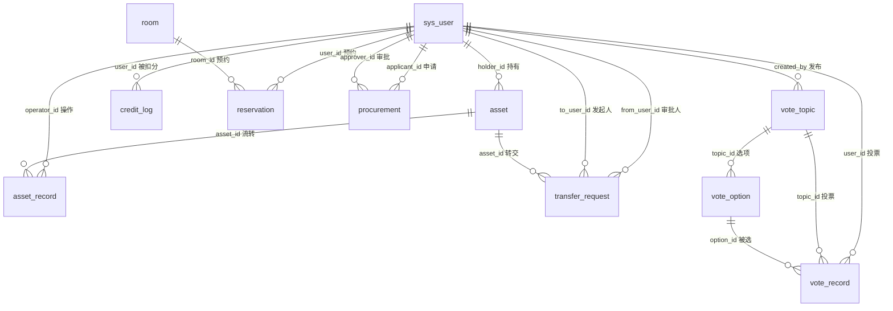
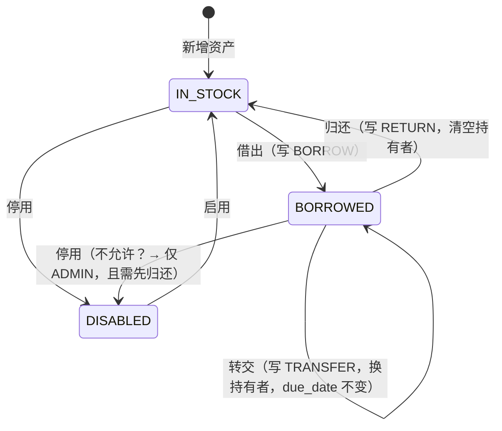

# 数据库设计说明书 — 企业资源调度与协同治理平台 (ERS)

## 0. 元数据

| 字段 | 值 |
|---|---|
| 文档类型 | 数据库设计说明书（A1） |
| 版本 | v1.0 — Frozen（2026-11-17） |
| 依赖 | PRD v1.3 §4、IA v1.3 §6（S1–S8 数据契约）、`db/schema.sql` v1.0、API 契约 v1.0 |
| 目标库 | MySQL 8.0+ / InnoDB / `utf8mb4` / `utf8mb4_0900_ai_ci` |
| 执行顺序 | `db/schema.sql` → `db/data.sql`（后者依赖前者） |
| 交付物 | `db/schema.sql`（275 行，12 表）、`db/data.sql`（种子数据）、本文档 |

---

## 1. 设计目标与原则

| 原则 | 落地方式 | 对应需求 |
|---|---|---|
| 单一资产实体 | 借出/转交/归还只改 `asset` 的状态与持有者，不复制资产行 | IA B5 |
| 审计事件流 | `asset_record` 只增不改，三类动作（BORROW/RETURN/TRANSFER）统一表 | IA A3 |
| 幂等与并发安全 | 用唯一键表达业务互斥：一资产一条待审批转交、一片段一条有效预约、每人一票、每人每日一类扣分一条 | PRD 4.2/4.3/4.4/4.6 |
| 状态以枚举存储 | `VARCHAR` + `CHECK` 约束，界面中文直出（不暴露编码） | IA A8 / S1 |
| 软删除最小化 | 仅 `procurement.deleted_at`（已驳回可删）；资产受限删除，优先停用 | PRD 4.2(7) |
| 策略外置 | `sys_config` 存信誉阈值、高价值阈值、借期、续借上限，管理员可改，无需发版 | IA B4 / S5 |
| 可追溯 | 每张业务表含 `created_at`；审批类含 `approver_id`/`decided_at` | 课程要求"安全性高" |

**通用约定**

- 主键：`BIGINT UNSIGNED AUTO_INCREMENT`，无业务含义。
- 时间：`DATETIME`（应用时区 `Asia/Shanghai`）；仅"日期"语义用 `DATE`。
- 金额：`DECIMAL(10,2)`，不用 `FLOAT`。
- 外键：均建 `RESTRICT` 外键（默认），防止脏数据；测试环境可临时 `SET FOREIGN_KEY_CHECKS=0` 重灌。
- 字符集：所有表 `utf8mb4`，所有连接串带 `characterEncoding=utf8mb4`。

---

## 2. ER 图



关系要点：

- `asset.holder_id` 为**当前持有者**，与 `asset_record` 的历史不重复存储（历史只在记录表）。
- `transfer_request` 的 `from_user_id` 是**审批人（当前持有者）**、`to_user_id` 是**发起人**——与命名直觉相反，代码注释必须写明（PRD 4.2(3)）。
- `credit_log.ref_id` 多态引用（`ref_type=ASSET` 指资产、`RESERVATION` 指预约），因此**不建外键**，靠应用保证。

---

## 3. 表清单总览

| # | 表名 | 中文名 | 预估行数 | 主要页面 |
|---|---|---|---|---|
| 1 | `sys_user` | 用户与角色 | 5–500 | P-AUTH、P-ADM-07 |
| 2 | `asset` | 资产台账 | 16–2000 | P-ASSET-01/02、P-ADM-02 |
| 3 | `asset_record` | 资产流转记录 | 8–10000 | P-ASSET-02 时间线 |
| 4 | `transfer_request` | 转交申请 | 1–1000 | P-ASSET-04 |
| 5 | `credit_log` | 信誉分流水 | 12–5000 | P-ME-01、P-HOME-01 |
| 6 | `room` | 场地 | 3–50 | P-ROOM-01、P-ADM-03 |
| 7 | `reservation` | 场地预约 | 6–10000 | P-ROOM-01/02 |
| 8 | `procurement` | 采购申请 | 3–2000 | P-PROC-01、P-ADM-04 |
| 9 | `vote_topic` | 投票活动 | 3–200 | P-VOTE-01、P-ADM-05 |
| 10 | `vote_option` | 投票选项 | 6–1000 | P-VOTE-02 |
| 11 | `vote_record` | 投票记录 | 5–5000 | P-VOTE-02 |
| 12 | `sys_config` | 系统配置 | 4–20 | P-ADM-06 |

---

## 4. 表结构字典

### 4.1 `sys_user` 用户与角色

| 字段 | 类型 | 空 | 默认 | 约束/说明 |
|---|---|---|---|---|
| id | BIGINT UNSIGNED | N | AI | 主键 |
| username | VARCHAR(32) | N | — | `uk_user_username` 唯一；3–32 位字母/数字/下划线 |
| password | VARCHAR(100) | N | — | BCrypt 密文；种子值 `__DEMO__` 由启动器替换 |
| real_name | VARCHAR(32) | N | — | 界面展示名 |
| role | VARCHAR(16) | N | `USER` | `CHECK IN ('USER','ADMIN')` |
| credit_score | INT | N | 100 | `CHECK >= 0`（下限 0） |
| status | TINYINT | N | 1 | 1 启用 / 0 停用；停用后登录返回 401 |
| created_at | DATETIME | N | 当前时间 | 注册时间（列表可搜索） |
| updated_at | DATETIME | N | 当前时间 | ON UPDATE |

索引：`uk_user_username(username)`、`idx_user_role_status(role,status)`。

### 4.2 `asset` 资产台账

| 字段 | 类型 | 空 | 默认 | 约束/说明 |
|---|---|---|---|---|
| id | BIGINT UNSIGNED | N | AI | 主键 |
| code | VARCHAR(32) | N | — | `uk_asset_code` 唯一，如 `A-0201` |
| name | VARCHAR(64) | N | — | 资产名称 |
| category | VARCHAR(32) | N | — | 电子设备 / 办公家具 / 工具 / 耗材 |
| value | DECIMAL(10,2) | N | 0.00 | `CHECK >= 0`；`>= 高价值阈值(500)` 判为高价值 |
| status | VARCHAR(16) | N | `IN_STOCK` | `IN_STOCK`/`BORROWED`/`DISABLED` |
| holder_id | BIGINT UNSIGNED | Y | NULL | 当前持有者；在库/停用为 NULL；FK → `sys_user.id` |
| borrow_at | DATETIME | Y | NULL | 本次借出时间 |
| due_date | DATE | Y | NULL | 应归还日 = 借出日 + `borrow.days`(3)；**转交不变** |
| renew_count | TINYINT | N | 0 | `CHECK BETWEEN 0 AND 3` |
| description | VARCHAR(255) | Y | NULL | 描述 |
| created_at / updated_at | DATETIME | N | 当前时间 | — |

索引：`idx_asset_status`、`idx_asset_holder`、`idx_asset_category`。

### 4.3 `asset_record` 资产流转记录

| 字段 | 类型 | 空 | 说明 |
|---|---|---|---|
| id | BIGINT UNSIGNED | N | 主键 |
| asset_id | BIGINT UNSIGNED | N | FK → `asset.id` |
| action | VARCHAR(16) | N | `BORROW`/`RETURN`/`TRANSFER` |
| operator_id | BIGINT UNSIGNED | N | 操作人：借用人 / 归还人 / 转交审批人 |
| target_user_id | BIGINT UNSIGNED | Y | 转交接收方 |
| from_status / to_status | VARCHAR(16) | Y | 状态变更前后 |
| remark | VARCHAR(255) | Y | 中文说明（时间线直出） |
| happened_at | DATETIME | N | 默认当前时间，时间线倒序依据 |

索引：`idx_record_asset_time(asset_id, happened_at DESC)`、`idx_record_operator`。**只增不改不删**（审计源）。

### 4.4 `transfer_request` 转交申请

| 字段 | 类型 | 空 | 说明 |
|---|---|---|---|
| id | BIGINT UNSIGNED | N | 主键 |
| asset_id | BIGINT UNSIGNED | N | FK → `asset.id` |
| from_user_id | BIGINT UNSIGNED | N | **当前持有者（审批人 A）** |
| to_user_id | BIGINT UNSIGNED | N | **拟接收人（发起人 B）** |
| status | VARCHAR(16) | N | `PENDING`/`APPROVED`/`REJECTED`/`CANCELLED` |
| apply_reason | VARCHAR(200) | Y | 发起说明 |
| reject_reason | VARCHAR(200) | Y | 拒绝时必填 |
| created_at / decided_at | DATETIME | — | 发起 / 审批时间 |
| pending_asset_id | BIGINT UNSIGNED | Y | **生成列**：`CASE WHEN status='PENDING' THEN asset_id END`，`uk_transfer_pending` 保证一资产仅一条待审批 |

约束：`CHECK from_user_id <> to_user_id`；索引 `idx_transfer_from(from_user_id,status)`、`idx_transfer_to(to_user_id,status)`。

### 4.5 `credit_log` 信誉分流水

| 字段 | 类型 | 空 | 说明 |
|---|---|---|---|
| id | BIGINT UNSIGNED | N | 主键 |
| user_id | BIGINT UNSIGNED | N | FK → `sys_user.id` |
| delta | SMALLINT | N | 变动值，通常 `-5`（负数扣分） |
| reason | VARCHAR(16) | N | `OVERDUE`/`NO_SHOW`/`ADMIN_ADJUST` |
| ref_type | VARCHAR(16) | N | `ASSET`/`RESERVATION` |
| ref_id | BIGINT UNSIGNED | Y | 多态引用，**无外键** |
| biz_date | DATE | N | 业务发生日（当日去重依据） |
| remark | VARCHAR(128) | Y | 说明，如"资产 A-0203 逾期 1 天" |
| created_at | DATETIME | N | 记录时间 |

**关键约束**：`UNIQUE uk_credit_daily(user_id, reason, ref_type, ref_id, biz_date)` —— 同一用户、同一原因、同一业务对象、同一天只允许一条，天然实现"逾期每日扣一次、汇总只扣一次"。

### 4.6 `room` 场地

| 字段 | 类型 | 空 | 说明 |
|---|---|---|---|
| id | BIGINT UNSIGNED | N | 主键 |
| name | VARCHAR(32) | N | `uk_room_name` 唯一 |
| location | VARCHAR(64) | Y | 楼层/楼栋 |
| capacity | INT | N | 可容纳人数，默认 1 |
| status | TINYINT | N | 1 可用 / 0 停用（停用不影响已产生预约） |
| created_at / updated_at | DATETIME | N | — |

### 4.7 `reservation` 场地预约

| 字段 | 类型 | 空 | 说明 |
|---|---|---|---|
| id | BIGINT UNSIGNED | N | 主键 |
| room_id | BIGINT UNSIGNED | N | FK → `room.id` |
| user_id | BIGINT UNSIGNED | N | FK → `sys_user.id` |
| reserve_date | DATE | N | 预约日期 |
| time_slot | TINYINT | N | `CHECK BETWEEN 0 AND 17`：0=09:00–09:30 … 17=17:30–18:00 |
| status | VARCHAR(16) | N | `BOOKED`/`CANCELLED`/`USED`/`NO_SHOW` |
| cancelled_at / checked_in_at | DATETIME | Y | 取消 / 标记使用时间 |
| active_slot | TINYINT | Y | **生成列**：`CASE WHEN status='BOOKED' THEN time_slot END`；`uk_reservation_slot(room_id,reserve_date,active_slot)` 保证同格仅一条有效预约 |

> 取消后 `active_slot` 变 NULL，唯一键不再冲突 → 同一格可被重新预约。

### 4.8 `procurement` 采购申请

| 字段 | 类型 | 空 | 说明 |
|---|---|---|---|
| id | BIGINT UNSIGNED | N | 主键 |
| title | VARCHAR(64) | N | 申请名称（必填） |
| reason | VARCHAR(200) | N | 申请理由（必填，≤200 字） |
| status | VARCHAR(16) | N | `PENDING`/`APPROVED`/`REJECTED` |
| applicant_id | BIGINT UNSIGNED | N | FK → `sys_user.id` |
| approver_id | BIGINT UNSIGNED | Y | FK → `sys_user.id`；自审时 = 申请人 |
| approve_note | VARCHAR(200) | Y | 审批备注；驳回时必填 |
| created_at / decided_at | DATETIME | — | 提交 / 审批时间 |
| deleted_at | DATETIME | Y | 逻辑删除（仅已驳回可删） |

> **本期不写 `asset` 表**：审批"同意入库"只改状态（IA B2 / PRD 4.5）。

### 4.9 `vote_topic` 投票活动

| 字段 | 类型 | 空 | 说明 |
|---|---|---|---|
| id | BIGINT UNSIGNED | N | 主键 |
| title | VARCHAR(64) | N | 活动标题 |
| description | VARCHAR(500) | Y | 说明 |
| deadline | DATETIME | N | 截止时间（到点自动停收，查询时判断） |
| status | VARCHAR(16) | N | `DRAFT`/`PUBLISHED`/`CLOSED` |
| created_by | BIGINT UNSIGNED | N | FK → `sys_user.id` |
| published_at / closed_at | DATETIME | Y | 发布 / 提前关闭时间 |
| created_at / updated_at | DATETIME | N | — |

### 4.10 `vote_option`

| 字段 | 类型 | 空 | 说明 |
|---|---|---|---|
| id | BIGINT UNSIGNED | N | 主键 |
| topic_id | BIGINT UNSIGNED | N | FK → `vote_topic.id`，`ON DELETE CASCADE` |
| label | VARCHAR(64) | N | 选项文案；`uk_option_topic_label(topic_id,label)` 防重 |
| sort_no | INT | N | 排序，默认 0 |

### 4.11 `vote_record`

| 字段 | 类型 | 空 | 说明 |
|---|---|---|---|
| id | BIGINT UNSIGNED | N | 主键 |
| topic_id | BIGINT UNSIGNED | N | FK → `vote_topic.id`，级联删除 |
| option_id | BIGINT UNSIGNED | N | FK → `vote_option.id` |
| user_id | BIGINT UNSIGNED | N | FK → `sys_user.id` |
| created_at | DATETIME | N | 投票时间 |

**关键约束**：`uk_vote_user(topic_id,user_id)` —— 每人每活动一票，不可改。

### 4.12 `sys_config`

| 字段 | 类型 | 空 | 说明 |
|---|---|---|---|
| id | BIGINT UNSIGNED | N | 主键 |
| config_key | VARCHAR(32) | N | `uk_config_key` 唯一 |
| config_value | VARCHAR(64) | N | 字符串存储，应用按类型解析 |
| description | VARCHAR(128) | Y | 中文说明 |
| updated_by | BIGINT UNSIGNED | Y | 最后修改管理员 |
| updated_at | DATETIME | N | 更新时间 |

种子键值：

| config_key | 值 | 含义 | 允许值 |
|---|---|---|---|
| `credit.threshold` | 60 | 信誉阈值，低于则限制借高价值 | 50/60/70/80 |
| `high_value.threshold` | 500 | 高价值资产金额阈值（元） | ≥0 |
| `borrow.days` | 3 | 固定借期 | 固定 3 |
| `renew.max.times` | 3 | 续借上限 | 固定 3 |

---

## 5. 状态机



| 实体 | 状态集合 | 允许迁移 | 禁止迁移（返回 422） |
|---|---|---|---|
| asset | `IN_STOCK` / `BORROWED` / `DISABLED` | 见上 | `BORROWED → DISABLED`（须先归还） |
| transfer_request | `PENDING` / `APPROVED` / `REJECTED` / `CANCELLED` | `PENDING → APPROVED/REJECTED`；`PENDING → CANCELLED`（发起人撤回，可选实现） | 终态再变更 |
| reservation | `BOOKED` / `CANCELLED` / `USED` / `NO_SHOW` | `BOOKED → CANCELLED`（开始前）；`BOOKED → USED`（开始后）；`BOOKED → NO_SHOW`（结束后由定时任务/查询判定） | 开始后取消 |
| procurement | `PENDING` / `APPROVED` / `REJECTED` | `PENDING → APPROVED/REJECTED` | 终态再变更；已驳回可软删 |
| vote_topic | `DRAFT` / `PUBLISHED` / `CLOSED` | `DRAFT → PUBLISHED`；`PUBLISHED → CLOSED` | `PUBLISHED → DRAFT`；`CLOSED → *` |

**预约爽约判定**：查询/定时任务扫描 `status='BOOKED' AND 结束时间 < 现在` 的记录 → 置 `NO_SHOW`，写 `credit_log(NO_SHOW, ref=reservation.id, biz_date=reserve_date, delta=-5)`；`uk_credit_daily` 保证只扣一次。

---

## 6. 关键业务 SQL / 事务

### 6.1 借出（防并发超借）

```sql
BEGIN;
UPDATE asset SET status='BORROWED', holder_id=?, borrow_at=NOW(),
       due_date=DATE_ADD(CURDATE(), INTERVAL ? DAY), renew_count=0
 WHERE id=? AND status='IN_STOCK';
-- affected rows = 0 → 回滚并返回 40900
INSERT INTO asset_record(asset_id, action, operator_id, from_status, to_status, remark)
VALUES (?, 'BORROW', ?, 'IN_STOCK', 'BORROWED', CONCAT(?, ' 借出 ', ?));
COMMIT;
```

### 6.2 转交审批（换人不换期）

```sql
BEGIN;
UPDATE transfer_request SET status='APPROVED', decided_at=NOW()
 WHERE id=? AND status='PENDING' AND from_user_id=?;   -- 校验审批人
UPDATE asset SET holder_id=? WHERE id=? AND status='BORROWED';
-- due_date / renew_count 不变
INSERT INTO asset_record(asset_id,'TRANSFER',from_user_id,target_user_id,'BORROWED','BORROWED','转交至李四，应归还日不变');
COMMIT;
```

### 6.3 逾期扣分（每日去重，幂等）

```sql
-- 定时任务：每天 00:05 跑一次，或查询时惰性计算（推荐定时 + 查询展示）
INSERT IGNORE INTO credit_log(user_id, delta, reason, ref_type, ref_id, biz_date, remark)
SELECT holder_id, -5, 'OVERDUE', 'ASSET', id, CURDATE(), CONCAT('资产 ', code, ' 逾期 1 天')
  FROM asset
 WHERE status='BORROWED' AND due_date < CURDATE() AND holder_id IS NOT NULL;
-- INSERT IGNORE 命中 uk_credit_daily → 当天不重复扣
UPDATE sys_user u JOIN (SELECT user_id, SUM(delta) d FROM credit_log GROUP BY user_id) x
   ON u.id=x.user_id SET u.credit_score = GREATEST(0, 100 + x.d);
```

> 信誉分采用「基准 100 + 流水求和、下限 0」的物化更新；`sys_user.credit_score` 为冗余展示值，权威值可由 `credit_log` 重算。续借成功后当天不再扣分（定时任务排除 `due_date >= CURDATE()`）。

### 6.4 预约切片占用

```sql
INSERT INTO reservation(room_id,user_id,reserve_date,time_slot,status)
VALUES (?,?,?,?, 'BOOKED');   -- 命中 uk_reservation_slot → 捕获 DuplicateKeyException → 40900
```

### 6.5 投票统计

```sql
SELECT o.id, o.label, COUNT(r.id) AS votes
  FROM vote_option o LEFT JOIN vote_record r ON r.option_id=o.id
 WHERE o.topic_id=? GROUP BY o.id, o.label ORDER BY o.sort_no, o.id;
-- 百分比在应用层计算（votes / totalVotes * 100，保留 1 位小数）
```

---

## 7. 索引与性能

| 查询场景 | 命中索引 |
|---|---|
| 资产目录按状态/关键词分页 | `idx_asset_status`（关键词 `LIKE 'x%'` 走 `uk_asset_code`/全表小数据可接受） |
| 我的借用 | `idx_asset_holder` |
| 资产时间线 | `idx_record_asset_time(asset_id, happened_at DESC)` |
| 待我审批转交 | `idx_transfer_from(from_user_id,status)`；`uk_transfer_pending` 防重 |
| 我的预约 | `idx_reservation_user(user_id,reserve_date)` |
| 场地某日切片 | `uk_reservation_slot(room_id,reserve_date,active_slot)` |
| 采购待审列表 | `idx_proc_status(status,deleted_at)` |
| 投票选项/记录 | `uk_vote_user`、`idx_vote_option` |
| 信誉流水 | `idx_credit_user_time(user_id, created_at DESC)` |

数据量估算：课程项目 ≤ 5000 行/表，上述索引足够；列表接口一律分页（默认 20），禁止 `SELECT *` 无 `LIMIT`。

---

## 8. 种子数据（`db/data.sql`）

| 表 | 行数 | 要点 |
|---|---|---|
| `sys_user` | 5 | `admin`(ADMIN)、`zhangsan`(USER,100)、`lisi`(USER,85,有一条逾期)、`wangwu`(USER,55,低于阈值)、`zhaoliu`(USER,100)；密码统一占位 `__DEMO__` |
| `asset` | 16 | 含 3 件借出（A-0201 张三 due 2026-11-19；A-0203 李四逾期 due 2026-11-14；A-0207 赵六）、1 件停用（A-0208）；高价值资产若干（投影仪 3800 元等） |
| `asset_record` | 8 | 覆盖 BORROW/RETURN/TRANSFER，供时间线/看板演示 |
| `transfer_request` | 1 | 投影仪 张三→李四，`PENDING`，用于演示"待我审批" |
| `credit_log` | 12 | 李四逾期 3 天、王五逾期 8 天 + 爽约 1 次 = 55 分 |
| `room` | 3 | 大会议室 / 小会议室 / 培训室 |
| `reservation` | 6 | 覆盖 BOOKED/USED/NO_SHOW/CANCELLED |
| `procurement` | 3 | 覆盖 PENDING/APPROVED/REJECTED |
| `vote_topic` | 3 | PUBLISHED（截止 2026-11-20）/ DRAFT / CLOSED（带 5 票） |
| `vote_option` | 9 | 每活动 2–4 项 |
| `vote_record` | 5 | 已关闭活动有票，进行中活动部分投票（用于演示"投前隐藏"） |
| `sys_config` | 4 | 见 §4.12 |

### 8.1 密码初始化（`__DEMO__` 占位的原因）

`db/data.sql` 不写任何真实密码，避免明文/弱哈希进仓库与文档；后端 `DataInitializer`（`ApplicationRunner`）首次启动时：

```
SELECT id FROM sys_user WHERE password = '__DEMO__';
for each: UPDATE sys_user SET password = BCrypt.encode(默认密码) WHERE id = ?;
```

默认演示密码统一为 `123456`（课程演示用），**生产环境必须改密**（`.env.example` 与部署手册注明）。幂等：执行后不存在 `__DEMO__` 行，不会重复编码。

---

## 9. 初始化、重置与备份

### 9.1 初始化（Windows · 中文路径注意）

```powershell
# 1) 建库与账号（root 执行一次）
mysql -uroot -p -e "CREATE DATABASE IF NOT EXISTS ers CHARACTER SET utf8mb4 COLLATE utf8mb4_0900_ai_ci;"
mysql -uroot -p -e "CREATE USER IF NOT EXISTS 'ers_app'@'localhost' IDENTIFIED BY '<密码>';"
mysql -uroot -p -e "GRANT SELECT,INSERT,UPDATE,DELETE,CREATE,ALTER,INDEX,DROP,REFERENCES ON ers.* TO 'ers_app'@'localhost'; FLUSH PRIVILEGES;"

# 2) 导入（mysql 客户端读不了中文路径 → 先复制到临时 ASCII 路径）
Copy-Item "D:\企业资源调度与协同治理平台\db\schema.sql" "$env:TEMP\ers_schema.sql" -Force
Copy-Item "D:\企业资源调度与协同治理平台\db\data.sql"   "$env:TEMP\ers_data.sql"   -Force
mysql -uers_app -p ers -e "source $env:TEMP/ers_schema.sql"
mysql -uers_app -p ers -e "source $env:TEMP/ers_data.sql"
```

> 已验证：12 张表 / users 5 / assets 16 / records 8 / transfers 1 / credits 12 / reservations 6 / proc 3 / topics 3 / votes 5 / cfg 4。

### 9.2 重置（清空重灌）

同一命令重复执行 `schema.sql`（含 `DROP TABLE IF EXISTS`）即可；**不要**只重跑 `data.sql`（会主键冲突）。

### 9.3 备份与还原

```powershell
mysqldump -uers_app -p --single-transaction --routines ers > "$env:TEMP\ers_backup.sql"
mysql -uers_app -p ers < "$env:TEMP\ers_backup.sql"
```

数据文件位置（体现"数据基于数据库文件存储"）：`C:\ProgramData\MySQL\MySQL Server 8.0\Data\ers\`（`.ibd` 文件）。

---

## 10. 与应用层的映射

| 数据库 | Java 实体（MyBatis-Plus） | 枚举类 | 备注 |
|---|---|---|---|
| `sys_user` | `SysUser` | `Role`、`UserStatus` | 不返回密码字段（`@JsonIgnore`） |
| `asset` | `Asset` | `AssetStatus` | `holderName` 非表字段，联表/DTO 填充 |
| `asset_record` | `AssetRecord` | `RecordAction` | 只插入，无 update/delete |
| `transfer_request` | `TransferRequest` | `TransferStatus` | `pending_asset_id` 标 `@TableField(exist=false)`（生成列只读，插入时忽略） |
| `credit_log` | `CreditLog` | `CreditReason`、`RefType` | 唯一键冲突需捕获（幂等） |
| `room` | `Room` | — | — |
| `reservation` | `Reservation` | `ReservationStatus` | `active_slot` 同样忽略写入 |
| `procurement` | `Procurement` | `ProcurementStatus` | 逻辑删除用 `deleted_at`（自定义或 `@TableLogic`） |
| `vote_topic` | `VoteTopic` | `VoteStatus` | 截止判定在 service（`now > deadline`） |
| `vote_option` | `VoteOption` | — | — |
| `vote_record` | `VoteRecord` | — | 唯一键冲突 → 409 |
| `sys_config` | `SysConfig` | — | 启动时加载为 `ConfigCache`，修改后刷新 |

---

## 11. 变更规则

1. 表结构变更必须同时更新 `db/schema.sql`、本文档 §4/§5、以及受影响的 API 契约。
2. 新增状态值需同步 `CHECK` 约束、Java 枚举、前端字典与 IA §6（中文直出）。
3. 禁止在应用代码中硬编码阈值（60/500/3/3），一律读 `sys_config`（IA B4）。
4. 任何唯一键（幂等/互斥）不得为"方便"而删除；如确需调整，先在测试计划中补并发用例。
